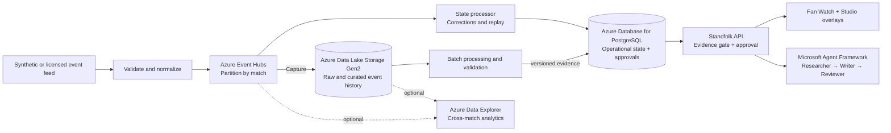

# Standfolk

<p align="center">
  
</p>

<p align="center"><strong>Evidence-backed match stories for fans and broadcast teams.</strong></p>

<p align="center">
  <a href="https://standfolk-web.wonderfulocean-6cd9ec2b.northeurope.azurecontainerapps.io">Open the live demo</a> ·
  <a href="docs/judge-guide.md">Follow the judge guide</a> ·
  <a href="docs/pitch.md">Read the project pitch</a>
</p>

> Every club, player, staff member, and match event in Standfolk is fictional. Match events are synthetic and clearly separated from authored career records.

## The match keeps changing. Its story should too.

In the featured Brenmoor League replay, Theo Marlow's 52nd-minute goal briefly puts Vellmouth Rovers ahead. At 55 minutes, an offside correction removes the goal: the score returns from 2–1 to 1–1, and any lower-third already on air is pulled. Sol Navarro scores at 66 minutes, so the final result is 2–1. The replay never reveals a correction before its match time.

Standfolk carries that changing match state into two connected experiences: fans can follow how a moment happened and who shaped it; producers can turn the same evidence into a reviewed story that is safe to approve for broadcast.

| Match time | What happens | What Standfolk shows |
| --- | --- | --- |
| 12′ and 38′ | Vellmouth score, then Kestrin equalise | Score-aware replay, pass sequence, and metres advanced |
| 52′ → 55′ | A goal stands provisionally, then is disallowed for offside | Corrected score and automatic withdrawal of its on-air graphic |
| 66′ → 90′ | Navarro scores; the match ends 2–1 | Updated replay and a sourced full-time recap |

## One match, two ways in

| Fan | Broadcast producer |
| --- | --- |
| Follow the replay, inspect a goal's build-up, and explore player careers, pronunciation, club history, and fan culture. | Review sourced moment stories, inspect agent steps, check edited copy, approve the exact version, and take a lower-third on air. |
| Choose English or Korean and short or detailed explanations. | Work from the same time-aware match facts with clear evidence and an API-enforced claim gate. |

The world contains 26 fictional clubs, with 20 in each season, 60 players and staff, and ten seeded seasons of authored history. The synthetic replay and career records retain separate provenance.

## From match evidence to an on-air story

1. **Researcher** gathers relevant match facts and world-pack sources up to the current replay time.
2. **Writer** drafts a short or detailed story for the selected audience.
3. **Reviewer** checks names and numeric claims. The workflow can request one rewrite; if review still fails or the model is unavailable, it uses a verified template.
4. **API and producer** re-check the claims, approve the exact copy and version, then publish the lower-third. A later match correction withdraws a now-invalid graphic.

The Microsoft Agent Framework makes the handoffs visible in Broadcast Studio. The API remains the final gate, so a fluent draft alone cannot go on air.

## Architecture

### Current demo

Two Azure Container Apps host the public web/API and the internal agent service. The replay is deterministic, the fictional world is bundled JSON, and SQLite FTS5 is an in-memory search index. Approval and on-air state are process-local; each app runs at most one replica.


### Proposed scale path

This is a future design; these services are not part of the deployed demo. Event Hubs can distribute normalized match events, PostgreSQL can hold transactional match and approval state, and Data Lake Storage Gen2 can retain raw and curated history. Azure Data Explorer is optional for cross-match analytics.



Events need stable IDs, provenance, versions, and correction handling. Before scaling replicas or adding licensed feeds, the design needs shared budgets, identity and access controls, monitoring, recovery, load tests, and measured cost. See the [Azure scale roadmap](docs/design/azure-scale-roadmap.md), or explore both interactive diagrams: [current demo](docs/architecture/current.html) and [proposed scale architecture](docs/architecture/future.html).

## Built with

- **Web:** React 19, TypeScript, Vite
- **API and match engine:** Node.js 22+, TypeScript, Fastify, SQLite FTS5
- **Agent service:** Python 3.12, FastAPI, Microsoft Agent Framework
- **Model provider:** Gemini through Google AI Studio's OpenAI-compatible endpoint; verified templates provide a fallback
- **Cloud:** Azure Container Apps and Bicep; GitHub Container Registry

## Run locally

Prerequisites: Node.js 22.13+ and Python 3.12+.

```bash
npm ci
python3 -m venv services/agents/.venv
services/agents/.venv/bin/pip install -r services/agents/requirements.txt
npm run dev
```

The dashboard, API, and agent service start at `http://localhost:5173`, `http://localhost:3001`, and `http://localhost:8001`. The agent environment is optional; without it, the API uses verified templates. To enable model-backed stories, add your own `MODEL_API_KEY` to a root `.env` file. `.env` is ignored by Git and must never be committed.

Run the offline checks with `npm run verify`; run the Python agent tests with `services/agents/.venv/bin/pytest services/agents`.

## Project links

- [Judge guide](docs/judge-guide.md)
- [Pitch](docs/pitch.md)
- [Architecture details](docs/architecture/README.md)
- [Third-party notices](THIRD_PARTY_NOTICES.md)
- [Hackathon challenge](https://innovationstudio.microsoft.com/hackathons/insidethegamedeveloperhackathon)
