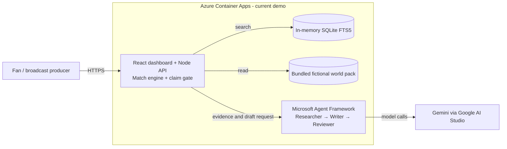
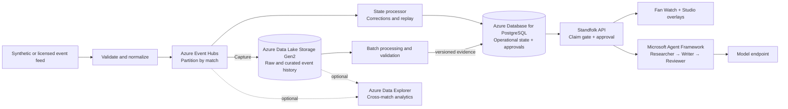

# Standfolk

**Know the game. Find your place.**

**Match insights, player journeys, and club culture.**

Standfolk is a hackathon project connecting explainable synthetic match insights with documented player journeys and club culture from an authored fictional football world. All clubs, players, staff, and competitions are fictional by design so no third-party trademarks or likenesses are used. It is built for broadcast producers preparing checkable stories and for new and international fans finding their way into football.

## Live demo & judge resources

- **Public demo (Azure Container Apps):** https://standfolk-web.wonderfulocean-6cd9ec2b.northeurope.azurecontainerapps.io *(scale-to-zero; first request after idle takes ~20 seconds)*
- **Judge guide (90-second walkthrough & acceptance verification):** [docs/judge-guide.md](docs/judge-guide.md)
- **Pitch (problem, audience, architecture, roadmap):** [docs/pitch.md](docs/pitch.md)

**Live check (2026-10-28):** Azure health returned HTTP 200. A Studio story completed Researcher → Writer → Reviewer in two model calls; an unsupported edit was blocked, supported copy was approved and aired, and the 55′ correction and 90′ recap were confirmed.

## What is built

- **Standfolk Watch:** follow the seeded matchday-9 synthetic replay (Vellmouth Rovers vs Kestrin Athletic), scrub the match clock, inspect deterministic goal build-up chains (pass count, metres gained, passer sequence), see the 52′ goal retracted at 55′ for offside without future leaks, view the automatic 90′ full-time recap, and receive approved broadcast overlays in real time.
- **Standfolk Studio:** review sourced match moments and their Microsoft Agent Framework steps (`Researcher → Writer → Reviewer`), inspect model-call telemetry, edit copy, block unsupported claims with **Check edit**, approve the exact checked version, and take lower-third overlays to air. The API withdraws an overlay if its moment is later retracted. **Show recovery (demo)** is an optional zero-model-call demonstration of critic catch → one rewrite → verified template fallback.
- **Standfolk Discover & Ask:** explore 26 fictional clubs (20 per season), 60 players and staff with 10 seeded seasons of career statistics, native-script name pronunciation, league basics and glossary, and a hybrid Ask engine combining zero-call verified templates with BM25 FTS5 retrieval.
- **Personalisation:** switch between **Fan** and **Broadcast** workspaces, **English** and **Korean** (`EN` / `KO`) story and recap copy, and **Short** or **Detailed** explanation depth.

The pipeline runs **ingest → interpret → explain → render → personalize**. Deterministic code computes every match statistic; synthetic match events are always labelled and kept separate from authored career records.

## Architecture & technology stack

### Current hackathon demo

The deployed demo runs two Azure Container Apps. The public app serves the React dashboard and Node API; the internal app runs the Microsoft Agent Framework workflow. Match facts come from a deterministic synthetic replay and an authored JSON world pack. SQLite FTS5 is an **in-memory search index**, not a persistent operational database. Approval, on-air state, rate limits, and budgets are process-local; the deployment is limited to one replica per app.



The API checks generated and producer-edited claims before approval and on-air publication. A retracted moment removes its overlay. Model or budget failures use verified templates. Explore the [current demo architecture](docs/architecture/current.html) or [proposed scale architecture](docs/architecture/future.html) as interactive Archify diagrams.

### Proposed Azure architecture for scale

**Future design only: these additional Azure services are not deployed or benchmarked in the demo.** The design separates transactional match and producer state from large-scale historical data, while retaining human approval and evidence checks.



Events need stable IDs, provenance, versioning and explicit correction/retraction handling. Shared budgets, identity, access controls, observability, recovery, cost and load testing must be designed before scaling replicas or integrating licensed data. PostgreSQL is the operational store; the lake and optional Data Explorer support historical and analytical workloads. [Explore the proposed Archify diagram locally](docs/architecture/future.html) and see the [Azure scale roadmap](docs/design/azure-scale-roadmap.md) for responsibilities and rollout stages.

### Stack

- **Dashboard (`apps/web`):** React 19, TypeScript, Vite.
- **API, match engine & retrieval (`apps/api`):** Node.js 22+, TypeScript, SQLite FTS5 (`node:sqlite` BM25 retrieval), deterministic seeded scenario engine (`apps/api/src/scenario.ts`), and server-side numeric/entity claim gate (`apps/api/src/agentClient.ts`).
- **Multi-agent story service (`services/agents`):** Python 3.12, FastAPI, **Microsoft Agent Framework** (`agent-framework-core`), calling Gemini (`gemini-3.5-flash-lite`) via Google AI Studio's OpenAI-compatible endpoint with automatic fallback to verified templates.
- **Deployment (`infra/`):** Azure Container Apps (`northeurope`, `standfolk-web` and `standfolk-agents`, Bicep IaC in `infra/main.bicep`) with container images on GitHub Container Registry (`ghcr.io/koooooh1`).

## Run locally (macOS, Linux, or Windows)

### Manual setup

1. Install Node.js 22.13+ and Python 3.12+.
2. Install Node workspace dependencies:
   ```bash
   npm install
   ```
3. Create the Python virtual environment for the agent service (optional; without it, the API runs in verified template mode):
   ```bash
   python3 -m venv services/agents/.venv
   services/agents/.venv/bin/pip install -r services/agents/requirements.txt
   ```
4. Copy `.env.example` to `.env` and optionally set `MODEL_API_KEY` (Google AI Studio API key).
5. Start the dashboard (`http://localhost:5173`), API (`http://localhost:3001`), and agent service (`http://localhost:8001`):
   ```bash
   npm run dev
   ```
6. Run the full verification suite (15 world tests, 91 API tests, 13 web tests, 59 Python agent tests, and production builds):
   ```bash
   npm run verify
   services/agents/.venv/bin/pytest services/agents
   ```

## Documentation

- [Judge guide](docs/judge-guide.md)
- [Pitch](docs/pitch.md)
- [Architecture and technology stack](docs/architecture/README.md)
- [Third-party notices](THIRD_PARTY_NOTICES.md)

The hackathon demonstration video is a separate submission asset.

## Hackathon

Prepared for [Inside the Game: Developer Hackathon](https://innovationstudio.microsoft.com/hackathons/insidethegamedeveloperhackathon). Official challenge requirements are maintained in the [organizer's repository](https://github.com/microsoft/insidethegamehackathon).
