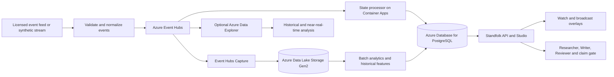

# Proposed Azure architecture for live operations

**Status: future design, not implemented or deployed.** The hackathon demo runs a single synthetic replay on Azure Container Apps, reads a bundled JSON catalog, uses in-memory SQLite for retrieval, and keeps approvals and on-air state in process. It does not ingest a live feed or use an Azure database. This design describes a possible path after the hackathon; it makes no throughput, latency, availability, or cost guarantee.

## Responsibilities

- **Event Hubs** buffers normalized match events for independent consumers. Partition by match ID so each match has a consistent processing path. Events need a stable provider ID, match ID, event time, ingestion time, schema version, provenance, and a revision or retraction reference. Consumers must handle duplicates, late events, replay, and corrections; ordering and delivery assumptions must be verified against the chosen feed and partitioning design.
- **Azure Database for PostgreSQL Flexible Server** is the proposed operational store for match state, player and club records, evidence references, story versions, approvals, and on-air decisions. Transactions and idempotency keys would protect state updates; an append-only revision history would retain corrections and audit context. Live overlays must be invalidated when a referenced event is retracted.
- **Azure Data Lake Storage Gen2** holds raw event history and curated datasets for replay, season comparisons, data quality checks, and offline analysis. Event Hubs Capture writes Avro by default; a separate processing step can produce curated Parquet. Synthetic, licensed, and personal data require separate provenance, access rules, retention, and permitted-use controls.
- **Azure Data Explorer**, if query volume and latency justify it, can provide near-real-time analytical queries across many matches. It is an optional analytical store, not a replacement for the transactional database. Batch processing can build historical aggregates from the lake; these become versioned evidence for the existing story workflow after validation.
- **Container Apps** continue to host the API, agent service, and a state processor. Shared state, rate limits, budgets, and story caches must move out of process before increasing replicas. Use managed identities where supported, least-privilege access, Azure Monitor metrics and alerts, and a tested recovery plan. Human approval and the claim gate remain part of the proposed publishing path.

## Delivery sequence

1. Add a synthetic event adapter and persistent PostgreSQL state; demonstrate duplicate delivery, late correction, replay, and restart recovery before accepting a real feed.
2. Add Event Hubs and lake capture when multiple simultaneous matches or retention requirements justify them. Measure event lag, correction propagation, data quality, and per-match cost.
3. Add analytical processing and, only if needed, Data Explorer for cross-match queries. Validate derived insights against source events and measure whether producers and fans benefit.
4. Integrate a licensed feed only after rights, data contracts, security, privacy, operational ownership, and recovery objectives are agreed. Load-test and cost the selected Azure tiers before deployment; budget alerts notify but are not a spending cap.

This is a proposed architecture, not evidence that the current demo can already ingest real match feeds or process big data at production scale.

## Microsoft references

- [Big data architectures](https://learn.microsoft.com/en-us/azure/architecture/databases/guide/big-data-architectures)
- [Azure Event Hubs overview](https://learn.microsoft.com/en-us/azure/event-hubs/event-hubs-about)
- [Event Hubs Capture](https://learn.microsoft.com/en-us/azure/event-hubs/event-hubs-capture-overview)
- [Managed identity with Azure Database for PostgreSQL](https://learn.microsoft.com/en-us/azure/postgresql/security/security-connect-with-managed-identity)
- [Container Apps storage](https://learn.microsoft.com/en-us/azure/container-apps/storage-mounts)
