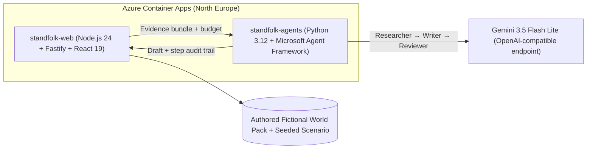

# Standfolk — Hackathon Pitch

**Know the game. Find your place.**  
Match insights, player journeys, and club culture.

- **Challenge:** The Synthetic Match Insights Engine for Premier League Studio ([Inside the Game: Developer Hackathon](https://innovationstudio.microsoft.com/hackathons/insidethegamedeveloperhackathon))
- **Live Demo (Azure Container Apps):** https://standfolk-web.wonderfulocean-6cd9ec2b.northeurope.azurecontainerapps.io

---

## 1. The Problem

Broadcast production teams need match stories they can verify before going on air, but turning a live match moment into a sourced story about the people involved is slow, manual work. At the same time, new and international fans watching a match see a goal or substitution without knowing who the players are, where they came from, or what the club means to its supporters.

Leaving this unsolved means broadcast stories that are either slow to produce or risky to air, and new fans who stay on the outside of the game.

---

## 2. What Standfolk Does

Standfolk follows a reproducible, football-realistic synthetic match event by event through a five-step pipeline — **Ingest → Interpret → Explain → Render → Personalize** — serving both broadcast producers and fans in one web application:

- **Standfolk Watch:** Follow the synthetic matchday-9 replay between Vellmouth Rovers and Kestrin Athletic with a live clock, inspect deterministic goal build-up chains (pass count, forward metres gained, and passer sequence), see a 52nd-minute goal disallowed at 55′ for offside update the score and pull any aired graphic automatically, read the automatic full-time recap at 90′, and jump from any moment straight to the player or club involved.
- **Standfolk Studio:** Producers review sourced moment stories drafted by a Microsoft Agent Framework workflow (`Researcher` → `Writer` → `Reviewer`), inspect agent steps and model-call telemetry, and edit copy with server-side claim verification (`POST /api/studio/stories/:id/check`). The API approves only the exact checked version before taking it to air (`POST /api/studio/stories/:id/approve`, then `/air`). Unreached or retracted moments are blocked; approved lower-thirds match `docs/schemas/overlay.schema.json` and appear on Watch. Demo approval state is process-local and has no login/RBAC. The optional **Show recovery (demo)** button runs two scripted wrong-figure drafts through the real reviewer to demonstrate error catching, one rewrite, and verified template fallback.
- **Standfolk Discover & Ask:** Explore player career timelines, loans, national-team records, manager backgrounds, club history, honours, fan culture, and league basics with data dates and sources. Ask questions answered by verified templates first and by BM25 keyword retrieval (`node:sqlite` FTS5) plus the agent workflow when templates cannot answer.
- **Separate workspaces:** A first-entry choice opens **Fan** on Watch, with top-level Watch, Stories, Players, and Table views; **Broadcast Studio** opens directly on the producer queue, with Match monitor, Head-to-head, and League table as supporting views. Studio is absent from Fan navigation. Both workspaces share the time-aware match event stream, while language (**English** / **Korean**) and explanation depth (**Short** / **Detailed**) remain configurable.

---

## 3. Multi-Agent Architecture & Microsoft / Azure Technology

### Exact Microsoft and Azure Technologies Used

1. **Microsoft Agent Framework (`agent-framework-core`, `agent-framework-openai`):**
   - Orchestrates three distinct roles in `services/agents/src/standfolk_agents/workflow.py`:
     - **Researcher:** Selects and formats the evidence bundle (synthetic match event + world-pack passages) without external network access.
     - **Writer:** Drafts broadcast or fan copy constrained strictly to the supplied evidence.
     - **Reviewer:** Checks every number and capitalised name against the grounding (`review.py`) and runs a model critic check. If a draft fails, the workflow performs **at most one rewrite** with the specific rejection reason; if the second draft also fails, or on any timeout/budget/provider error, it falls back to the **verified deterministic template**.
2. **Azure Container Apps & Bicep (`infra/main.bicep`):**
   - Deployed in **North Europe** (`rg-standfolk`) as two Container Apps in one environment:
     - `standfolk-web` (external HTTPS ingress, port 8080): serves the built React dashboard and the Fastify API from a single origin.
     - `standfolk-agents` (internal-only ingress, port 8001): reachable only by `standfolk-web` inside the Container Apps environment.
3. **GitHub Container Registry & GitHub Actions (`.github/workflows/ci.yml`):**
   - Multi-stage Dockerfiles (`infra/web.Dockerfile`, `infra/agents.Dockerfile`) run as non-root users. CI runs the Node world-pack, API and web tests and production builds on pushes and pull requests; Python agent tests are run separately.

### Model provider

The agent workflow uses Gemini (`gemini-3.5-flash-lite`) through Google AI Studio’s OpenAI-compatible endpoint and Microsoft Agent Framework. A verified deterministic template is used when model output is unavailable or fails validation.

---

## 4. Truth, Safety, and Trademark Compliance

- **Two-Layer Claim Gate:** Deterministic TypeScript code calculates all match facts. Every agent output and every producer edit is checked by both `services/agents/src/standfolk_agents/review.py` and `apps/api/src/agentClient.ts` (`unsupportedClaim`), rejecting any figure (digits or spelled-out words) or capitalised name absent from the evidence.
- **Strict Provenance Separation:** Synthetic match performance (`synthetic match`) and authored career records (`seeded world pack`) never share a sentence and never overwrite each other.
- **Fictional World by Design (Rule 4.4 Compliance):** All 26 clubs in the fictional world (20 compete in each season), all 60 players and staff, and all 10 seeded seasons (`data/world/authored.json`, seed `20261023`) are original fictional creations with custom-generated portraits and crests. No third-party trademarks, real club crests, or real player likenesses are used. A licensed real-data integration would require new adapters, rights and validation.

## 5. Proposed Azure production path

The current demo uses a bundled fictional catalog and in-process state. For future live operations, a feed adapter could publish normalized events to Azure Event Hubs; Azure Database for PostgreSQL could persist match state, story versions and approvals; and Event Hubs Capture could archive events to Azure Data Lake Storage Gen2 for historical analysis. Azure Data Explorer is an optional later analytical store. Corrections, provenance, access controls, recovery, measured latency and cost must be designed and tested before production. These services are **proposed, not deployed or benchmarked**. See the [Azure scale roadmap](design/azure-scale-roadmap.md).
